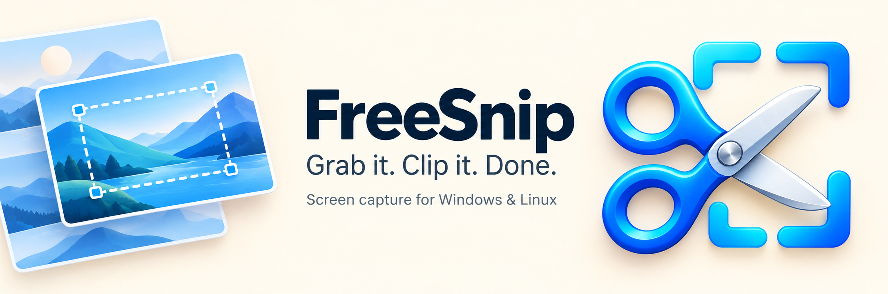
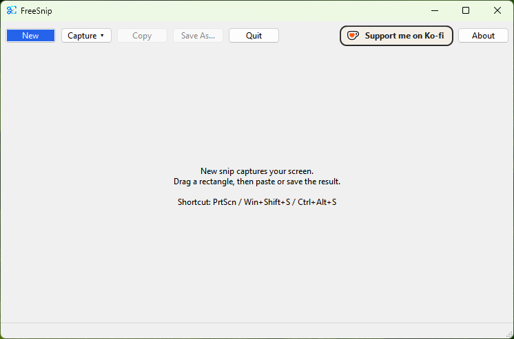
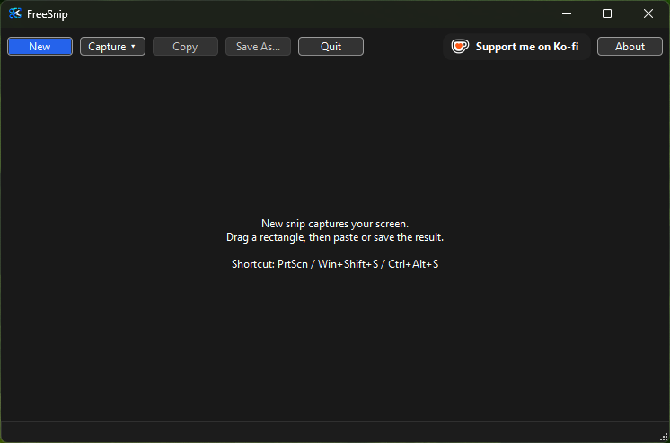
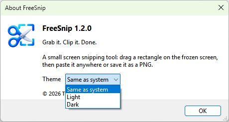

<p align="center">
  
</p>

# FreeSnip

**Grab it. Clip it. Done.**

A lightweight screen capture tool for Windows and Linux. Capture a region, a
window, or your desktop, then paste it straight into a chat, document, or image
editor. Save a PNG when you need a file.

Choose a Windows installer or portable ZIP, a Linux AppImage, or a Flatpak with
SteamOS support. The Windows app runs as a single executable with no services,
Store app, or extra runtime dependencies unlike the current Windows 11 snipping tool.

**[Downloads](#downloads) · [Screenshots](#screenshots) · [Quick start](#quick-start) · [Keyboard shortcuts](#keyboard-shortcuts) · [Building from source](#building-from-source)**

## Features

- **Capture just what you need** — select a rectangle, capture a window, or grab the full desktop.
- **Ready to paste** — completed snips go straight to the clipboard. Paste with Ctrl+V or save as PNG.
- **Made for multiple monitors** — capture across displays, with snips taken at the screenshot's full pixel resolution.
- **Close at hand** — start a capture from the window, tray, or a keyboard shortcut.
- **Native light and dark themes** — follow the system theme or choose your own under **About → Theme**.
- **A small native app** — built with C++ and wxWidgets for Windows and Linux.

## Screenshots

### Screen capture, in light or dark

Start a new snip, choose a capture mode, then copy or save the result.

<table>
  <tr><th>Light theme</th><th>Dark theme</th></tr>
  <tr>
    <td><a href="images/main_window_lite.png"></a></td>
    <td><a href="images/main_window_dark.png"></a></td>
  </tr>
</table>

<details>
<summary>Theme settings</summary>

Choose **Same as system**, **Light**, or **Dark** under **About → Theme**.



</details>

## Downloads

FreeSnip is packaged in four formats. Choose the package for your platform;
`<version>` in these filenames is the release number.

| Download | File |
|---|---|
| Windows installer (64-bit) | `FreeSnip-<version>-windows-x64-setup.exe` |
| Windows portable (64-bit) | `FreeSnip-<version>-windows-x64-portable.zip` |
| Linux AppImage (Ubuntu 22.04 and newer, SteamOS) | `FreeSnip-<version>-linux-x86_64.AppImage` |
| Linux Flatpak (including SteamOS) | `FreeSnip-<version>-linux-x86_64.flatpak` |

`SHA256SUMS.txt` contains the package checksums.

- **Windows installer:** installs for the current user without administrator rights,
  with a Start menu shortcut and optional desktop shortcut and start at sign-in.
- **Windows portable:** unzip anywhere and run `freesnip.exe`.
- **AppImage:** make the file executable and run it. If FUSE 2 (`libfuse2`) is
  unavailable, launch it with `--appimage-extract-and-run`.
- **Flatpak:** open the bundle in your software installer. On SteamOS, use Desktop
  Mode. See the [Linux guide](docs/linux-build.md#install-on-ubuntu-or-steamos)
  for installation commands and runtime details.

## Quick start

1. Install or unpack FreeSnip and launch it.
2. Click **New** to start a capture. On Windows, you can also press **Win+Shift+S**.
3. Drag a rectangle over the area you want. Release to capture it.
4. Paste with **Ctrl+V**, or choose **Save As...** to save a PNG.

While selecting, press **Enter** to capture the monitor under the pointer, or
**Esc** / right-click to cancel. The selection shows its size in pixels.

Use **Capture** for the other capture modes. **Copy** puts the current snip back on
the clipboard. Launching FreeSnip again uses the running instance.

### On Windows

Choose **Capture → Window**, or press **W** during selection and click a highlighted
window. Press **R** to return to rectangle selection. Window captures include the
title bar and visible window area; bring the window to the front to avoid capturing
anything covering it.

Closing the main window keeps FreeSnip in the tray. Click the tray icon for a new
snip, or right-click it for capture options, **Show FreeSnip**, **Start with Windows**,
and **Exit**. Use **Quit** to exit completely.

### On Linux

On Wayland, FreeSnip requests a screenshot through the desktop's screenshot portal;
your desktop may ask permission. On X11, it captures the screen directly.

**Capture → Active window** depends on support from the desktop's portal.
**Desktop options** opens the desktop's own picker. Picking a window with **W**
on the frozen screen is Windows-only.

Closing the window hides it when a tray is available; otherwise it exits.
**Keep FreeSnip running until you have pasted** — the Linux clipboard can empty
when the app that owns it quits. See the [Linux guide](docs/linux-build.md)
for tray support, desktop shortcuts, and display behavior.

## Keyboard shortcuts

| Shortcut | Action |
|---|---|
| **Win+Shift+S** | Start a capture on Windows |
| **PrtScn** / **Ctrl+Alt+S** | Additional Windows capture shortcuts, when available |
| **Ctrl+N** | Start a rectangle capture from the app |
| **Ctrl+Shift+W** | Window capture on Windows; active-window capture on Linux |
| **Ctrl+C** | Copy the current snip |
| **Ctrl+S** | Save the current snip as PNG |
| **Ctrl+Q** | Quit FreeSnip |
| **Enter**, during selection | Capture the monitor under the pointer |
| **Esc** / **right-click**, during selection | Cancel capture |
| **W** / **R**, during selection | Switch between window and rectangle selection on Windows |

On Linux, use **Shortcut...** to request a capture key through the desktop's
GlobalShortcuts portal, or configure a shortcut in your desktop settings.

<details>
<summary>Windows shortcut troubleshooting</summary>

The tray tooltip lists the shortcuts FreeSnip registered. If Windows reserves
**Win+Shift+S**, FreeSnip handles that combination while it is running. Exiting
FreeSnip releases it; no system remapping is saved.

If PrtScn does nothing, Windows has it reserved: turn off *Settings >
Accessibility > Keyboard > Use the Print screen key to open screen capture*,
then restart FreeSnip.

</details>

<details>
<summary>Theme and launch options</summary>

Choose **Same as system**, **Light**, or **Dark** under **About → Theme**. On Windows,
the change applies the next time FreeSnip starts; on Linux, it applies immediately.

| Platform | Start a capture | Start quietly in the tray |
|---|---|---|
| Windows | `freesnip.exe /snip` | `freesnip.exe /tray` |
| Linux | `freesnip --snip` | `freesnip --tray` |

For Flatpak, use `flatpak run io.github.tcottrill.FreeSnip//preview` in place of
`freesnip`.

</details>

## Support

If FreeSnip is useful to you, you can [support its development on Ko-fi](https://ko-fi.com/timcottrill).
The app also includes a **Support me on Ko-fi** button.

## Building from source

FreeSnip uses C++17 and wxWidgets 3.3.4. Initialize the wxWidgets submodule after
cloning:

```sh
git submodule update --init --recursive
```

**Windows:** use Visual Studio 2022 with the C++ tools and Ninja, then run:

```powershell
.\tools\build-windows.ps1
```

`build.bat` is also available. The output is `dist/freesnip.exe`, with wxWidgets
and the C runtime statically linked. The build runs a smoke test using a synthetic
image; it does not capture the desktop or change the clipboard.

To work in the Visual Studio 2022 IDE, run `vs2022.bat` (or
`.\tools\make-vs2022.ps1 -Open`). It generates `build\vs2022\FreeSnip.sln` with
CMake and opens it, with `freesnip` as the startup project. Release builds
`dist\freesnip.exe` and Debug builds `dist\debug\freesnip.exe`. Run it again after
adding or removing source files.

**Linux:** see the [Linux build guide](docs/linux-build.md#build) for Flatpak and
AppImage builds, dependencies, and tests.

<details>
<summary>Packaging and release builds</summary>

`tools/build-all.ps1` builds everything from this Windows checkout (Linux through
WSL) and collects it in `dist/release/` with `SHA256SUMS.txt`, named with the
version in `CMakeLists.txt`:

The steps on their own: `tools/build-windows.ps1`, `tools/build-installer.ps1`
(Inno Setup 6), `tools/build-linux-appimage.sh` and `tools/build-linux.sh` +
`tools/package-flatpak.sh` (in WSL; see the Linux doc), then
`tools/collect-release.ps1`. `-SkipLinux` builds only the Windows files.

</details>

<details>
<summary>Source layout and icons</summary>

Icons: `tools/make-icons.py` (Pillow) scales the artwork in `packaging/icons/freesnip.png`
to `packaging/icons` (Linux icon theme PNGs and `freesnip.ico`); the program compiles in
the 256 px PNG for its window, tray and About icons.

The UI is in `src/wx`. Capture, clipboard, shortcuts, the tray and the single
instance are platform code: `src/wx/platform_windows.cpp` and
`src/wx/platform_linux.cpp`.

`src/monitor_select.*` is a vendored copy of `C:\Source2026\shared\monitor_select`.

</details>

## License

Copyright (C) 2026 Tim Cottrill

This program is free software: you can redistribute it and/or modify it under the
terms of the GNU General Public License as published by the Free Software
Foundation, either version 3 of the License, or (at your option) any later version.
It is distributed in the hope that it will be useful, but WITHOUT ANY WARRANTY;
without even the implied warranty of MERCHANTABILITY or FITNESS FOR A PARTICULAR
PURPOSE. See [LICENSE](LICENSE) for the full text.

wxWidgets keeps its own license (wxWindows Library Licence,
`vendor/wxWidgets/docs/licence.txt`).
